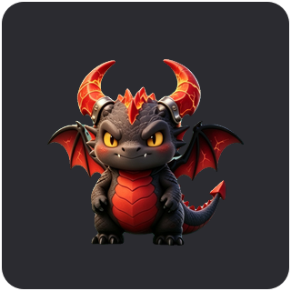
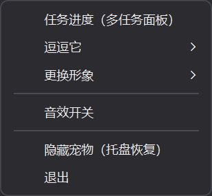
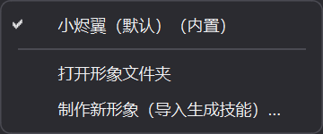

# CinderWing — a desktop dragon that reports your AI tasks

> A chibi black-and-red baby dragon living on your Windows desktop. It breathes,
> blinks, breathes fire, and wobbles when you drag it — and it watches the
> asynchronous agents running in **Doubao Work (豆包工作)**. When a task starts,
> makes progress, needs your decision, or finishes, the dragon tells you in a
> speech bubble with a progress bar — just like OpenAI Codex Pets. Click the
> bubble to jump straight back to that conversation.






- Current release: **v1.2.0 — skin packs + the Asset Forge skill**
- Stack: Python 3.13 · PySide6 (transparent frameless always-on-top window) ·
  rembg/u2net (AI cutout) · ccl_chromium_reader (IndexedDB reader) · PyInstaller
- Platform: Windows 10/11 (single-instance, tray icon, optional auto-start)

> 中文文档：[README.md](README.md)

---

## Features

**Desktop companion**
- Subtle belly breathing while idle, occasional blinks and scratches; ignored
  long enough, it curls up and sleeps (with a breathing rise; click to wake)
- Click the head for a fire breath, the body for a lunge; it also cheers and
  yawns. Drag it around and it sways slowly; release it and it gets dizzy
- 52 hand-tuned 2D sprite frames (AI-generated sheets + semantic cutout +
  programmatic polish), 5 sound effects, one-click mute

**Task awareness (Codex Pets style)**
- Read-only parsing of the Doubao Work client's local IndexedDB, polled every
  3 seconds — no API keys, no extra accounts, no server
- Clear speech bubbles with progress bars for task start / thinking / tool
  calls / decisions needed / done / failed
- Multi-task panel: one live progress row per task; click to open the
  conversation via a deep link
- When the agent asks a multiple-choice question, **clickable option buttons
  are rendered right inside the bubble**; clicking an option jumps to the chat
  card where you confirm and send it
- Decision bubbles stay on screen until handled

**Desktop control**
- Right-click menu: task panel, play actions (fire / lunge / cheer / sleep),
  sound toggle, hide pet, quit
- Mirrored tray menu; double-click the tray to show/hide; optional auto-start

**Skins (v1.2.0)**
- Pluggable character packs: each pet is a folder under `packs/<id>/`
  (9 animation sets + `pack.json`); missing animations fall back to the
  built-in dragon
- Switch instantly from the right-click menu; the choice is persisted. Drop
  third-party packs into the skins folder to install them
- **Asset Forge skill**: one click installs an AI image-generation skill into
  Doubao Work. Upload one character concept image, and the AI generates all 9
  animation sheets on a cyan screen, then `tools/pack_build.py` cuts them out,
  aligns frames, renders a magenta QA contact sheet, and packages a switchable
  skin

---

## Repository layout

```
.
├─ app/                  # The pet application
│  ├─ main.py            # Entry point: real data source / --sim demo mode
│  ├─ pet_window.py      # Transparent window, sprite animation, input, menus
│  ├─ bubble.py          # Speech bubbles, progress bars, panel, option buttons
│  ├─ task_source.py     # IndexedDB polling, task state machine, blob fallback
│  ├─ sprite_anim.py     # Sprite frame player
│  ├─ sfx.py             # Sounds and mute toggle
│  ├─ tray.py            # Tray icon and menu
│  ├─ activator.py       # doubaowork:// deep links + window foreground fallback
│  ├─ dev_sim.py         # Simulated tasks (includes a decision point)
│  └─ paths.py           # Dev/frozen resource and data directories
├─ assets/
│  ├─ frames/            # 52 finished frames (9 sets, 256×256 transparent PNG)
│  ├─ sfx/               # 5 wav sound effects
│  ├─ core/              # Character anchor image
│  ├─ sheets/            # Raw AI-generated sprite sheets (pipeline input)
│  └─ app.ico            # Application icon
├─ tools/                # Build, test, screenshot and diagnostic scripts
│  ├─ build_frames.py    # Built-in dragon art pipeline: sheets -> frames
│  ├─ pack_build.py      # Generic pack builder: any character sheets -> pack
│  ├─ build_exe.bat      # One-click packaging
│  ├─ installer/         # Auto-start install/uninstall
│  └─ test_*.py          # Automated tests
├─ skills/               # AI skills shipped with the app
│  └─ cinderwing-asset-forge/  # Asset Forge (concept image -> full animation set)
├─ docs/                 # Milestone walkthroughs (in Chinese)
├─ pet.spec              # PyInstaller config
├─ requirements.txt      # Runtime dependencies
└─ requirements-dev.txt  # Packaging dependencies (PyInstaller)
```

---

## Quick start (development)

Requires Windows and Python 3.13.

```powershell
# 1. Create a venv and install dependencies
python -m venv .venv
.\.venv\Scripts\python.exe -m pip install -r requirements.txt

# 2. Launch (reads real tasks from the local Doubao Work client)
.\.venv\Scripts\python.exe -m app.main

# 3. Demo mode without real tasks (simulates two tasks, one with a choice)
.\.venv\Scripts\python.exe -m app.main --sim
```

The tray menu's "simulate full task flow" item triggers the whole show anytime.

### Build the exe

```powershell
.\.venv\Scripts\python.exe -m pip install -r requirements-dev.txt
tools\build_exe.bat
```

Output lands in `dist\CinderWing\` — double-click `CinderWing.exe` to run.
Run `tools\installer\开机自启-安装.bat` once to enable auto-start. Logs and
config are written to `%APPDATA%\CinderWing\` (the v1.1.x `GeoHarbourPet`
folder is migrated automatically on first launch).

### Regenerate animation frames (optional)

Drop AI-generated cyan-screen sprite sheets into `assets/sheets/`, then:

```powershell
$env:U2NET_HOME = "$PWD\tools\.u2net"
.\.venv\Scripts\python.exe tools\build_frames.py              # all sets
.\.venv\Scripts\python.exe tools\build_frames.py idle blink   # selected sets
```

The u2net model (~176 MB) is not bundled; rembg downloads it to `tools/.u2net/`
on first run.

### Create / install a new skin

**Option A — the Asset Forge skill (recommended):** right-click the pet →
"更换形象" (Change skin) → "制作新形象（导入生成技能）…" (Make a new skin).
Then open a new Doubao Work conversation, upload a character concept image,
and ask the Asset Forge to build the skin. See
[`skills/cinderwing-asset-forge/`](skills/cinderwing-asset-forge/) for the
spec.

**Option B — build manually:** prepare cyan-screen sheets for the 9 animation
sets, put them in a folder with a `sheets.json`, then:

```powershell
$env:U2NET_HOME = "$PWD\tools\.u2net"
.\.venv\Scripts\python.exe tools\pack_build.py .\my-sheets `
  --id my-pet --name "My Pet" --author "Your Name"
```

The pack lands in the skins folder (`assets/packs/` in dev,
`%APPDATA%\CinderWing\packs\` when packaged) and becomes switchable from the
menu; a magenta QA sheet `qa_my-pet.png` is generated for frame-by-frame
inspection.

---

## How does it know task states?

The Doubao Work client stores conversations and tasks in a local Chromium
IndexedDB (`…\IndexedDB\chrome_doubaowork-chat_0.indexeddb.leveldb`). Every
3 seconds the app copies that directory to a temp folder **read-only**, parses
the `samantha-web` database's `default-chat-im-protocol-store` with
ccl_chromium_reader, and reads `mainTaskDataMap` for:

- whether an entry is a real agent task (`general_task_param` flag)
- question text, conversation id / section id (for deep links)
- the content-block stream: text / reasoning / tool calls / timing /
  interaction_ask decision blocks
- terminal signals (the `is_finish=1` time window)

Progress is a conservative pseudo-estimate from block types (thinking 18% →
tools from 28% → capped at 96% → 100% on terminal). Large values live in
`.blob` files; since v1.1.0 they are matched by exact declared byte size when
index lookup fails. **Everything is read-only; the client database is never
written to.**

---

## Tests

```powershell
$env:QT_QPA_PLATFORM = "offscreen"
.\.venv\Scripts\python.exe tools\test_m6_packs.py
.\.venv\Scripts\python.exe tools\test_m5_menu_ask.py
.\.venv\Scripts\python.exe tools\test_m3_jump.py
.\.venv\Scripts\python.exe tools\_test_source_once.py
```

---

## Privacy, trademarks and license

**Privacy (local and read-only)**

- The app only reads local database snapshots of the Doubao Work client and
  opens conversations via system protocol handlers. There is no server, no
  data collection and no telemetry, and **nothing is ever written to the
  client database**.
- Local snapshots and task dumps (which may contain chat content) live under
  `tools/_m2work/` and temp directories; they are excluded via `.gitignore`
  and are never committed.

**Trademarks and unofficial-project notice**

- CinderWing is an independent personal open-source learning project. It is
  **not affiliated with, endorsed by, or certified by ByteDance or Doubao
  Work**; "Doubao"/"Doubao Work" and other names are trademarks of their
  respective owners.
- This repository contains no third-party copyrighted game character assets;
  the default dragon "CinderWing" is an original chibi design. If you build
  packs based on other characters, you are responsible for copyright
  compliance — do not redistribute infringing assets.

**License**

- Source code: **MIT License** — see [LICENSE](LICENSE).
- Art, sound and other creative assets (`assets/`, `docs/images/`):
  **CC BY-NC 4.0** (Attribution-NonCommercial) — see
  [assets/LICENSE](assets/LICENSE).
- Third-party components keep their own licenses: ccl_chromium_reader (see its
  repository), PySide6 (LGPL/commercial), and PyInstaller (see its terms).
