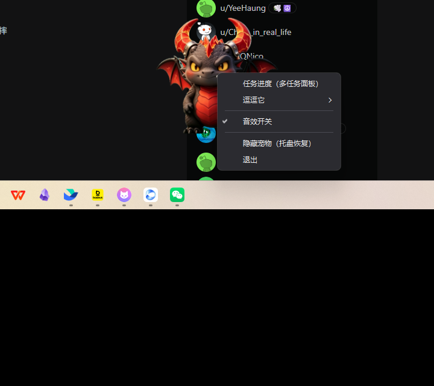
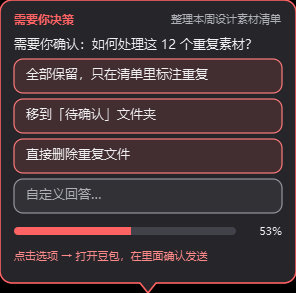
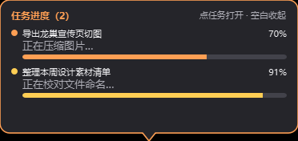

# CinderWing · 小烬翼桌面宠物

> 一只停在 Windows 桌面上的 Q 版黑龙幼崽：会呼吸、会眨眼、会喷火、会被拖得晃来晃去；
> 它还盯着**豆包工作（Doubao Work）**里的异步任务——任务开始、推进、需要你决策、完成，
> 都会像 OpenAI Codex Pets 那样用文字气泡明确汇报，点一下就能跳回对应会话。






- 当前版本：**v1.1.0（M5）**
- 技术栈：Python 3.13 · PySide6（透明无边框置顶窗口）· rembg/u2net（AI 抠像）· ccl_chromium_reader（IndexedDB 读取）· PyInstaller（打包）
- 平台：Windows 10/11（本机自用，单实例驻留 + 托盘 + 开机自启）

---

## 功能一览

**桌面演出（对标炉石收藏宠物）**
- 闲置时极轻微的腹式呼吸、偶尔眨眼、偶尔挠痒；长时间不理它会蜷起来睡觉（带起伏，点击唤醒）
- 点头部喷火、点身体扑咬、开心欢呼、打哈欠等点击反应；可拖拽，被拎起时缓慢晃动，松手会晕一下
- 52 帧 2D 序列帧（AI 生成 + 语义分割抠像 + 程序化加工），5 个音效，可一键静音

**任务感知（对标 Codex Pets）**
- 只读解析豆包工作客户端的本地 IndexedDB，3 秒轮询，无需接口、无需登录额外账号
- 任务开始 / 思考 / 调用工具 / 需要决策 / 完成 / 失败，均有明确文字气泡 + 进度条
- 多任务进度面板：每个任务一行实时进度，点击跳转到豆包工作对应会话（deep-link）
- **AI 抛出选择题时，气泡里直接渲染可点击选项**，点选项跳到会话卡片处确认发送
- 决策气泡常驻不自动消失，直到处理

**桌面控制（v1.1.0）**
- 宠物右键菜单：任务进度、逗逗它（喷火/扑咬/开心欢呼/去睡觉）、音效开关、隐藏宠物、退出
- 托盘菜单同步；双击托盘切换显隐；支持开机自启

---

## 目录结构

```
.
├─ app/                  # 桌宠程序本体
│  ├─ main.py            # 入口：真实数据源 / --sim 模拟模式
│  ├─ pet_window.py      # 透明窗口、精灵动画、鼠标交互、右键菜单
│  ├─ bubble.py          # 文字气泡、进度条、多任务面板、决策选项按钮
│  ├─ task_source.py     # 豆包工作 IndexedDB 轮询、任务状态机、blob 兜底解析
│  ├─ sprite_anim.py     # 序列帧播放器
│  ├─ sfx.py             # 音效与开关
│  ├─ tray.py            # 托盘图标与菜单
│  ├─ activator.py       # doubaowork:// deep-link 跳转 + 窗口前置兜底
│  ├─ dev_sim.py         # 开发用模拟任务（含选择题决策点）
│  └─ paths.py           # 开发态 / 打包态的资源与数据目录
├─ assets/
│  ├─ frames/            # 52 帧成品动画（9 套，256×256 透明 PNG，运行期直接使用）
│  ├─ sfx/               # 5 个 wav 音效
│  ├─ core/              # 角色长相锚点图
│  ├─ sheets/            # AI 生成的原始条图（美术流水线输入，可替换/增补）
│  └─ app.ico            # 程序图标
├─ tools/                # 构建、测试、截图、排障脚本（见 tools/README.md）
│  ├─ build_frames.py    # 美术流水线：条图 → 成品帧
│  ├─ build_exe.bat      # 一键打包
│  ├─ installer/         # 开机自启安装/卸载
│  └─ test_*.py          # 自动化测试
├─ docs/                 # 每个里程碑的白话讲解（零基础向）+ 外部 AI 生图需求单
├─ pet.spec              # PyInstaller 配置
├─ requirements.txt      # 运行依赖
├─ requirements-dev.txt  # 打包依赖（PyInstaller）
└─ 启动宠物.bat           # 开发态双击启动（自动清掉冲突的环境变量）
```

---

## 快速开始（开发态）

需要 Windows + Python 3.13。

```powershell
# 1. 建虚拟环境并装依赖
python -m venv .venv
.\.venv\Scripts\python.exe -m pip install -r requirements.txt

# 2. 直接启动（读取本机豆包工作的真实任务）
.\启动宠物.bat
#   或：.\.venv\Scripts\python.exe -m app.main

# 3. 不依赖真实任务的演示模式（会模拟两条任务，含选择题决策点）
.\.venv\Scripts\python.exe -m app.main --sim
```

托盘里有"模拟任务全流程"，也可以随时触发完整演出。

### 打包成 exe

```powershell
.\.venv\Scripts\python.exe -m pip install -r requirements-dev.txt
tools\build_exe.bat
```

产物在 `dist\小死亡之翼桌宠\`，双击 exe 即跑；`tools\installer\开机自启-安装.bat`
双击一次即可开机自启。打包后日志与配置写在 `%APPDATA%\GeoHarbourPet\`。

### 重新生成动画帧（可选）

把外部 AI 生成的青蓝底条图放进 `assets/sheets/`（要求见
[`docs/外部AI生图需求单.md`](docs/外部AI生图需求单.md)），然后：

```powershell
$env:U2NET_HOME = "$PWD\tools\.u2net"
.\.venv\Scripts\python.exe tools\build_frames.py        # 全量
.\.venv\Scripts\python.exe tools\build_frames.py idle blink tap1   # 只重建指定套
```

u2net 模型（约 176MB）不随仓库提供，首次运行 rembg 会自动下载到 `tools/.u2net/`。

---

## 它是怎么知道任务状态的？

豆包工作客户端把会话与任务数据存在本地 Chromium IndexedDB
（`…\IndexedDB\chrome_doubaowork-chat_0.indexeddb.leveldb`）。
程序每 3 秒把该目录**只读快照**到临时目录，用 ccl_chromium_reader 解析
`samantha-web` 库的 `default-chat-im-protocol-store`，从 `mainTaskDataMap` 中提取：

- 任务是否为真实 Agent 任务（`general_task_param` 标记）
- 问题文本、会话 id / section id（用于 deep-link 跳转）
- 内容块流：文本 / 思考 / 工具调用 / 计时 / interaction_ask 决策块等
- 终态信号（`is_finish=1` 的时间窗）

进度按块类型做保守的伪进度估算（思考 18% → 工具 28% 起 → 封顶 96% → 终态 100%）。
大任务值外置在 `.blob` 文件中，v1.1.0 起在编号索引失效时按数据声明的精确字节数兜底匹配。
**全程只读，不向客户端数据库写任何内容。**

---

## 开发历程（零基础向白话讲解）

| 里程碑 | 内容 | 文档 |
|---|---|---|
| M0 | 透明无边框窗口、托盘、单实例 | [M0讲解.md](docs/M0讲解.md) |
| M1 | AI 美术流水线、9 套 52 帧动画、互动 | [M1讲解.md](docs/M1讲解.md) |
| M2 | IndexedDB 任务事件源与状态机 | [M2讲解.md](docs/M2讲解.md) |
| M3 | 通知气泡、进度条、多任务面板、deep-link 跳转 | [M3讲解.md](docs/M3讲解.md) |
| M4 | PyInstaller 打包、开机自启（v1.0.0） | [M4讲解.md](docs/M4讲解.md) |
| M5 | 右键菜单、决策选项按钮、blob 解析修复（v1.1.0） | [M5讲解.md](docs/M5讲解.md) |

测试：

```powershell
$env:QT_QPA_PLATFORM = "offscreen"
.\.venv\Scripts\python.exe tools\test_m5_menu_ask.py
.\.venv\Scripts\python.exe tools\test_m3_jump.py
.\.venv\Scripts\python.exe tools\_test_source_once.py
```

---

## 隐私与版权说明

- **纯本地运行**：程序只读取本机豆包工作的本地数据库与通过系统协议打开会话，
  不含任何自建服务端，不收集、不上报任何数据。
- **私有数据不入库**：本地数据库快照、任务 dump（可能含聊天内容）位于
  `tools/_m2work/` 与临时目录，已被 `.gitignore` 排除，不会提交。
- **美术资源仅供个人学习自用**：角色形象参考暴雪《魔兽世界》小死亡之翼 /
  《炉石传说》收藏宠物风格，相关形象版权归原权利人所有。
  本仓库不公开分发、不商用、不用于任何对外发布；如需公开请先替换为原创角色素材。
- 第三方组件 ccl_chromium_reader 遵循其自身许可证（见其仓库说明）。
